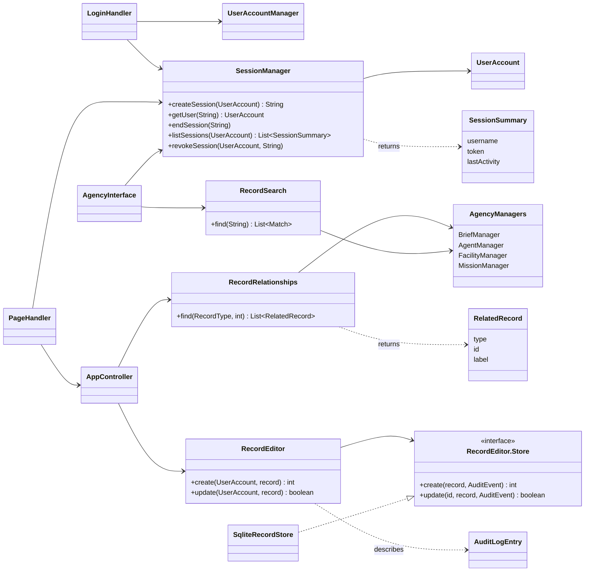
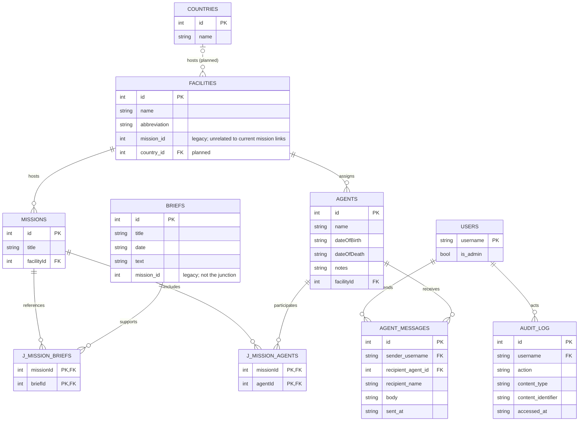

# Homework 7 model and session design

## Class diagram

The class diagram reflects the implemented record editing, related records,
search, and session administration paths.



For an edit, the authenticated controller sends a complete validated model to
the editor. The store uses one connection and one transaction for the record,
any junction changes, and the audit entry. Mission relation updates replace
the selected associations atomically. A missing ID or invalid reference
produces no audit row. The controller never sends form input as a table or
column name.

## ERD

The current database has the entities below except `COUNTRIES`. Its PK and
the facility FK are proposed integration points for Team A. Field names in
the existing tables reflect the current SQLite schema.



`AUDIT_LOG.content_identifier` is text because it can identify records from
different tables or account actions. Tokens and their last-activity times
are in-memory server state. Passwords live in separate ciphered files.

## Web detail wireframe

```text
[Menu]  [Facilities]  [Agents]  [Missions]  [Briefs]  [Log out]
Facility · Blackwood Annex                           [Edit]
Abbreviation  BA
Country       [Team A country integration pending]
Agents        [Vanguard]   [Ghost]
Missions      [Recon]
```

Brackets mark links or actions. Edit is shown only to administrators. An
unassigned group can display “None.” Agent detail links to its facility and
missions, Mission detail links to its facility, briefs, and agents, and
Brief detail links to its assigned missions.

## Terminal wireframes

```text
Search records
Text: nightbird
Agent 12  Mira
Returns to the main menu after listing results.
```

```text
Manage web sessions (administrator)
Username   Token                   Last activity (UTC)
ghost      <full session token>    2026-11-12T20:29:00Z
Token to revoke, r to refresh, or Enter to return:
```

The session screen lists active tokens without refreshing their activity.
After revocation, the next browser request using that token goes to login.

## Current country dependency

The shared branch contains an unfinished `Country` class, without a country
manager, database table, facility foreign key, or country route. Country
links and country text search depend on Team A completing that feature.
The proposed country table and relationship above identify the integration
point. The implemented relationship service currently resolves facilities,
agents, missions, and briefs from the existing tables.
