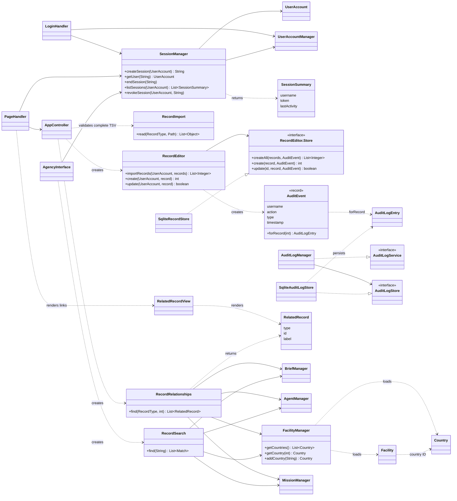
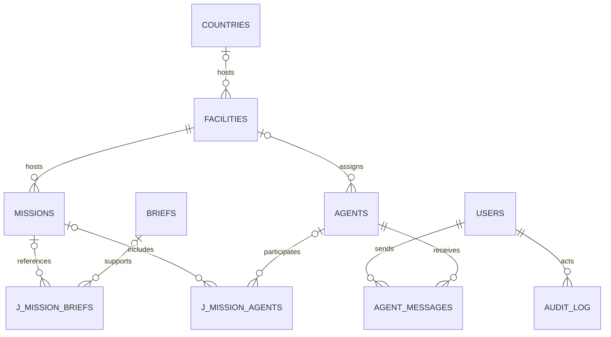

# Homework 7 model and session design

## Class diagram

Verified against NewDatabaseManagerRefactor at `65e2fd2` on 2026-11-20.
This is Team D's scope; gray external boundaries in the PDF are maintained by
other roles. The whole-system class PDF is a separate shared deliverable.

- [Team D class diagram and compiled API inventory](TeamD-ClassDiagram.pdf)
- [Entity/relationship diagram without column details](TeamD-ERD.pdf)
- [Team D related-data, search, and session wireframes](TeamD-Wireframes.pdf)

The diagrams represent implemented behavior, not unfinished backlog fixes.



For an edit, the authenticated controller sends a complete validated model to
the editor. The store uses one connection and one transaction for the record,
any junction changes, and the audit entry. Mission relation updates replace
the selected associations atomically. A missing ID or invalid reference
produces no audit row. The controller never sends form input as a table or
column name.

## ERD

The database contains the entities below. The country table is seeded from
Team A's Countries enum using stable numeric IDs. Existing facilities are
migrated by adding a nullable country_id column. Unassigned legacy facilities
retain their data until a user selects a country. New and edited facilities
require an existing country through the current forms.



This conceptual ERD intentionally contains entity names and relationships only,
as requested by the rubric. Physical schemas are recorded separately below.
Optional parent cardinalities reflect nullable foreign keys in the actual DDL,
including junction columns; application-valid mission links use positive IDs.
No FK connects audit content identifiers to each content table.

`AUDIT_LOG.content_identifier` is text because it can identify records from
different tables or account actions. Tokens and their last-activity times
are in-memory server state. Passwords live in separate ciphered files.

## Web detail wireframe

```text
Top Secret
[Menu] [Briefs] [Agents] [Facilities] [Countries] [Facilities] [Missions] [Messages] [Audit log] [Log out]

Facilities
Name: Blackwood Annex
Abbreviation: BA
Country: United States
[Edit facility]

Related records
- [country · United States]
- [agent · Vanguard]
- [agent · Ghost]
- [mission · Recon]
```

Brackets mark links or actions. Edit is shown only to administrators.
The duplicated Facilities link is current shared behavior and is flagged for the
navigation owner. Team C owns the Messages destination and its screen designs. An
unassigned group can display “None.” Agent detail links to its facility and
missions, Mission detail links to its facility, briefs, and agents, and
Brief detail links to its assigned missions.

## Terminal wireframes

```text
Search records
Text: nightbird
agent 12. Mira
Returns to the main menu after listing results.
```

```text
Manage web sessions (administrator)
Username   Token                   Last activity (UTC)
ghost      <full session token>    2026-11-12T20:29:00Z
Token to revoke, r to refresh, or Enter to return:
```

The session screen lists active tokens without refreshing their activity.
After revocation, the next browser request using that token goes to login.

## Country initialization and editing

FacilityManager initializes the country table from the supplied enum, preserving
edited country names and preventing duplicate seeding on later starts. Country
names can be changed and new country IDs can exceed the original seed count.

The Countries menu opens the list and the existing create/edit form workflow.
Facilities select their country by its listed numeric ID. Related links connect
a country with its assigned facilities. Editing the country's name changes the
label displayed at each linked facility without rewriting those facilities.
Country names are included in terminal search.

The pre-country Facility constructor and two-column TSV imports remain
supported. Such legacy records have an unassigned country until edited.

## Country and facility forms

```text
Countries
[New country]
[1. Afghanistan]
[2. Albania]
...

Edit facility
Name                      [Blackwood Annex]
Abbreviation              [BA]
Country ID                [1]
[Save] [Cancel]
```

New/Edit actions are available to administrators. A new country form requests
a name. Changing a facility's Country ID changes its association.

## Follow-up reliability changes

Terminal content prompts feed AppController's existing form-value contract.
The controller validates references and uses RecordEditor/SqliteRecordStore for
one content-and-audit transaction. The package-visible AgencyInterface
constructor permits injecting that persistence boundary for isolated tests.
Terminal administrator checks reload account metadata, including after prompts
and immediately before creation or permission changes.

MissionManager propagates mission/junction read failures as IllegalStateException.
WebServer responds with 503, so EditHandler cannot render a failed read as an
empty association list. New audit entries use UTC consistently; historical
naive timestamps are retained without guessing their original time zone.

WebServer rejects POST requests with a foreign or opaque Origin, or cross-site
fetch metadata, before dispatching handlers. Session cookies use SameSite=Lax.
The application serves HTTP directly; origin validation compares against its
HTTP Host header. HTTPS reverse-proxy deployments would need explicit trusted
public-origin configuration rather than accepting arbitrary forwarded headers.
These reliability changes add no tables. See the current physical schema below.

## Physical schema notes (separate from the ERD)

The SQL below was read from sqlite_master after initializing the current managers
and messaging store in a disposable database. It describes fresh databases.
Existing databases receive the country/read-status migrations; SQLite preserves
legacy constraints when a column is added. Agent and junction foreign keys permit
SQL NULL even though normal model writes require positive references. Legacy
brief/facility mission fields are not the mission junction relationships.

Team C owns agent_messages; its definition is included only as the database
integration boundary. The read-status field must also appear in their class and
wireframe documentation. Team D's conceptual ERD deliberately omits all columns.

```sql
CREATE TABLE agent_messages (
    id INTEGER PRIMARY KEY AUTOINCREMENT,
    sender_username TEXT NOT NULL REFERENCES users(username),
    recipient_agent_id INTEGER NOT NULL REFERENCES agents(id),
    recipient_name TEXT NOT NULL COLLATE NOCASE CHECK(length(trim(recipient_name)) > 0),
    body TEXT NOT NULL CHECK(length(trim(body, char(9) || char(10) || char(13) || ' ')) > 0),
    sent_at TEXT NOT NULL,
    is_read INTEGER NOT NULL DEFAULT 0 CHECK(is_read IN (0, 1))
);

CREATE TABLE agents (
    id INTEGER PRIMARY KEY,
    name TEXT NOT NULL,
    dateOfBirth DATE NOT NULL,
    dateOfDeath DATE,
    notes TEXT,
    facilityId INTEGER,
    FOREIGN KEY (facilityId) REFERENCES facilities (id)
);

CREATE TABLE audit_log (
    id INTEGER PRIMARY KEY AUTOINCREMENT,
    username TEXT NOT NULL REFERENCES users(username),
    action TEXT NOT NULL,
    content_type TEXT NOT NULL,
    content_identifier TEXT NOT NULL,
    accessed_at TEXT NOT NULL
);

CREATE TABLE briefs (
    id INTEGER PRIMARY KEY,
    title TEXT NOT NULL,
    date DATE NOT NULL,
    text TEXT NOT NULL,
    mission_id INTEGER UNIQUE
);

CREATE TABLE countries (id INTEGER PRIMARY KEY, name TEXT NOT NULL);

CREATE TABLE facilities (
    id INTEGER PRIMARY KEY,
    name TEXT NOT NULL,
    abbreviation TEXT NOT NULL,
    country_id INTEGER REFERENCES countries(id),
    mission_id INTEGER
);

CREATE TABLE j_mission_agents
(
missionId INTEGER,
agentId INTEGER,
PRIMARY KEY (missionId, agentId),
FOREIGN KEY (missionId) REFERENCES missions(id) ON DELETE CASCADE,
FOREIGN KEY (agentId) REFERENCES agents(id) ON DELETE CASCADE
);

CREATE TABLE j_mission_briefs
(
missionId INTEGER,
briefId INTEGER,
PRIMARY KEY (missionId, briefId),
FOREIGN KEY (missionId) REFERENCES missions(id) ON DELETE CASCADE,
FOREIGN KEY (briefId) REFERENCES briefs(id) ON DELETE CASCADE
);

CREATE TABLE missions
(
 id INTEGER PRIMARY KEY,
 title TEXT NOT NULL,
 facilityId INTEGER NOT NULL,

 CONSTRAINT fk_facility FOREIGN KEY (facilityId) REFERENCES facilities(id) ON DELETE CASCADE
);

CREATE TABLE users (username TEXT NOT NULL PRIMARY KEY, is_admin INTEGER NOT NULL DEFAULT 0);

```

No passwords or session tokens are stored in these tables. Credential files are
ciphered separately; web sessions and last-activity instants live in memory.
Content CREATE/UPDATE, assignments, and audit commit together through
SqliteRecordStore. Administrator terminal TSV imports now parse the entire file
through RecordImport before createAll writes the batch, one CREATE per record,
and one aggregate IMPORT event atomically. Invalid rows/references/audit writes
leave no partial imported records. Startup sample loading retains its existing
empty-table bootstrap path.

Account insertion uses the additive users_unique_identity trigger to reject
case-equivalent usernames. Existing legacy ambiguous rows are retained; messaging
continues to fail closed for them. First-account bootstrap writes the ciphered
credential file before metadata and attempts file cleanup if either step fails.
SQLite and the filesystem do not share a distributed transaction.

The shared HTTP server uses a bounded worker pool so one incomplete form cannot
block all clients; forms larger than 64 KiB are rejected. This is not a guarantee
against exhausting every worker with stalled connections.
