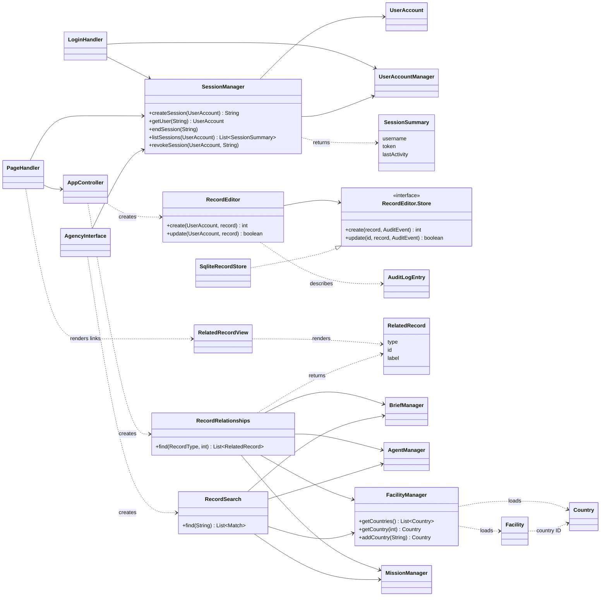
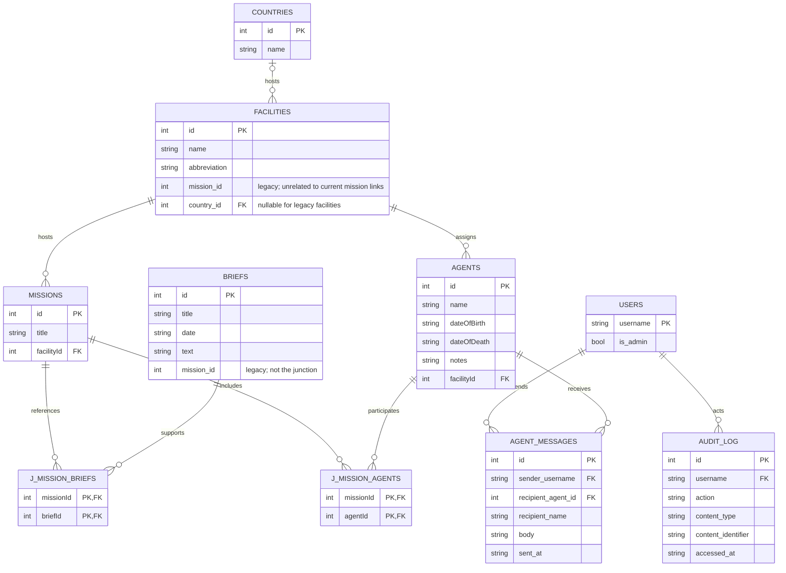

# Homework 7 model and session design

## Class diagram

The class diagram reflects the implemented record editing, related records,
search, and session administration paths.



For an edit, the authenticated controller sends a complete validated model to
the editor. The store uses one connection and one transaction for the record,
any junction changes, and the audit entry. Mission relation updates replace
the selected associations atomically. A missing ID or invalid reference
produces no audit row. The controller never sends form input as a table or
column name.

## ERD

The database contains the entities below. The country table is seeded from
Team A's Countries enum using stable numeric IDs. Existing facilities are
migrated by adding a nullable country_id column. Unassigned legacy facilities
retain their data until a user selects a country. New and edited facilities
require an existing country through the current forms.



`AUDIT_LOG.content_identifier` is text because it can identify records from
different tables or account actions. Tokens and their last-activity times
are in-memory server state. Passwords live in separate ciphered files.

## Web detail wireframe

```text
Top Secret
[Menu] [Briefs] [Agents] [Facilities] [Countries] [Audit log] [Log out]

Facilities
Name: Blackwood Annex
Abbreviation: BA
[Edit facility]

Related records
- [country · United States]
- [agent · Vanguard]
- [agent · Ghost]
- [mission · Recon]
```

Brackets mark links or actions. Edit is shown only to administrators. An
unassigned group can display “None.” Agent detail links to its facility and
missions, Mission detail links to its facility, briefs, and agents, and
Brief detail links to its assigned missions.

## Terminal wireframes

```text
Search records
Text: nightbird
agent 12. Mira
Returns to the main menu after listing results.
```

```text
Manage web sessions (administrator)
Username   Token                   Last activity (UTC)
ghost      <full session token>    2026-11-12T20:29:00Z
Token to revoke, r to refresh, or Enter to return:
```

The session screen lists active tokens without refreshing their activity.
After revocation, the next browser request using that token goes to login.

## Country initialization and editing

FacilityManager initializes the country table from the supplied enum, preserving
edited country names and preventing duplicate seeding on later starts. Country
names can be changed and new country IDs can exceed the original seed count.

The Countries menu opens the list and the existing create/edit form workflow.
Facilities select their country by its listed numeric ID. Related links connect
a country with its assigned facilities. Editing the country's name changes the
label displayed at each linked facility without rewriting those facilities.
Country names are included in terminal search.

The pre-country Facility constructor and two-column TSV imports remain
supported. Such legacy records have an unassigned country until edited.

## Country and facility forms

```text
Countries
[New country]
[1. Afghanistan]
[2. Albania]
...

Edit facility
Name                      [Blackwood Annex]
Abbreviation              [BA]
Country ID (see Countries) [1]
[Save] [Cancel]
```

New/Edit actions are available to administrators. A new country form requests
a name. Changing a facility's Country ID changes its association.

## Follow-up reliability changes

Terminal content prompts feed AppController's existing form-value contract.
The controller validates references and uses RecordEditor/SqliteRecordStore for
one content-and-audit transaction. The package-visible AgencyInterface
constructor permits injecting that persistence boundary for isolated tests.
Terminal administrator checks reload account metadata, including after prompts
and immediately before creation or permission changes.

MissionManager propagates mission/junction read failures as IllegalStateException.
WebServer responds with 503, so EditHandler cannot render a failed read as an
empty association list. New audit entries use UTC consistently; historical
naive timestamps are retained without guessing their original time zone.

WebServer rejects POST requests with a foreign or opaque Origin, or cross-site
fetch metadata, before dispatching handlers. Session cookies use SameSite=Lax.
The application serves HTTP directly; origin validation compares against its
HTTP Host header. HTTPS reverse-proxy deployments would need explicit trusted
public-origin configuration rather than accepting arbitrary forwarded headers.
The schema, ERD, and wireframe remain unchanged by these reliability fixes.
